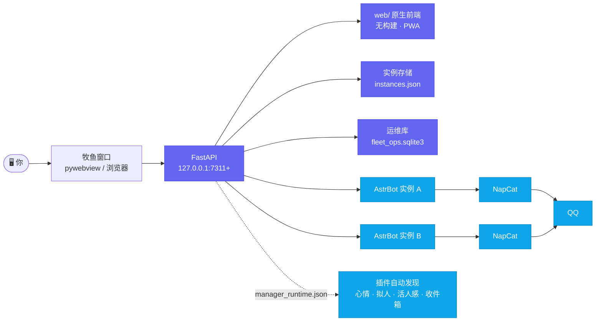
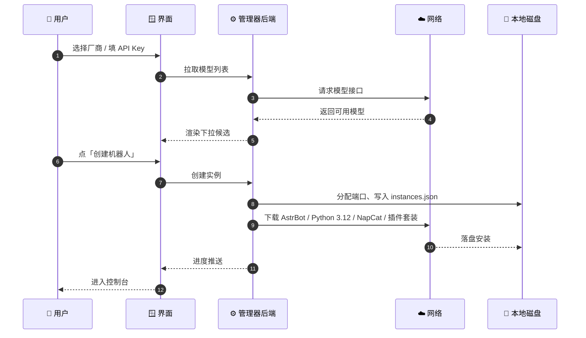

<div align="center">


<a href="https://github.com/nansheng1810/muyu-manager">
  
</a>

<p>
  
  
  
  
  
</p>

<p>
  
  
  
</p>

**本地运行的 Windows 桌面管理台** —— 建机器人、装运行环境、装插件、看监控、跑自动化，全部收进一个窗口。

<sub>🐟 不用记命令行，不用手改配置，不用在十几个窗口之间来回切</sub>

[✨ 亮点](#-亮点雷达) · [🚀 快速开始](#-快速开始) · [🧩 功能地图](#-功能地图) · [🧭 架构](#-架构一览) · [📦 打包](#-打包发版) · [🔐 数据安全](#-数据与安全)

</div>

---

## ✨ 亮点雷达

<table>
<tr>
<td width="50%" valign="top">

### ⚡ 一键部署
只填一个 API Key。自动识别可用模型、测试连通性，然后安装 AstrBot 运行环境、Python 3.12、NapCat 和 **19 个插件套装**，全程无人值守。

</td>
<td width="50%" valign="top">

### 🛰️ 多实例统管
创建、导入、发现实例；启停重启、端口分配、Dashboard 免密直达、NapCat 状态监控与自动重连，一台管理器管一片。

</td>
</tr>
<tr>
<td width="50%" valign="top">

### 🧠 拟人化能力
长期记忆、人物档案、在场状态、心情与行为节奏、人格风格、表情包、看图接话，让它不只是一个复读机。

</td>
<td width="50%" valign="top">

### 🎙️ 语音回复
接入驰风 Breeze TTS：音色设计、声音克隆、试听、一键开关，内置「大肥鱼 · 深海软语」人声预设，支持直连 / 隧道 / 公网三种连法。

</td>
</tr>
<tr>
<td width="50%" valign="top">

### 🤖 自动化流水线
定时任务、DSH Bridge、发布检查、效果评估，把重复劳动交给调度器。

</td>
<td width="50%" valign="top">

### 📺 B 站发布
bili-cli 扫码登录、自动发布参数、本地视频手动投稿与投稿记录，创作到发布一条链。

</td>
</tr>
</table>

> [!TIP]
> 浏览器直接访问也能用。支持 **PWA**，可以「添加到桌面」，获得接近原生应用的体验。

---

## 🧩 功能地图

| 模块 | 能力 |
| :--- | :--- |
| 🚀 **部署** | 首屏只填 API Key · 自动拉取模型列表 · 一键创建机器人 · 下载失败自动切镜像 |
| 🗂️ **实例** | 创建 / 导入 / 发现 · 启停与重启 · 端口分配 · Dashboard 免密直达 · NapCat 自动重连 |
| 📊 **监控** | 实例总览 · 健康检查 · 告警 · 任务调度 · 审批 · 备份与运维面板 |
| 💬 **消息中心** | QQ / B 站消息收件箱 · 自动回复与人工审核 · 双机对话 · 群聊增强 |
| 🎭 **拟人化** | 长期记忆 · 人物档案 · 在场状态 · 心情与行为节奏 · 人格风格 · 表情包 · 看图接话 |
| 🎙️ **语音** | 驰风 Breeze TTS · 音色设计 · 声音克隆 · 试听 · 人声预设增删改 · 音色锁定 · 合成缓存 LRU |
| ⏱️ **自动化** | 定时任务 · DSH Bridge · 发布检查 · 效果评估 |
| 📺 **B 站** | 扫码登录 · 自动发布参数 · 本地视频投稿 · 投稿记录 |
| 📱 **PWA** | 浏览器访问 · 添加到桌面 · 离线外壳缓存 |

---

## 🧭 架构一览



<details>
<summary><b>🔍 展开：一次「一键部署」背后发生了什么</b></summary>

<br/>



</details>

---

## 🚀 快速开始

### 运行要求

| 依赖 | 说明 |
| :--- | :--- |
| 🪟 **Windows 10 / 11** | 唯一支持的平台 |
| 🐍 **Python 3.12** | 仅源码模式需要 |
| 🌐 **Microsoft Edge WebView2** | Win11 自带；缺失时自动回退 Edge App 或默认浏览器 |
| 🟢 **Node.js 18+** | 仅用于跑前端测试 |

### 方式一 · 打包版（推荐）

> 下载 Release 里的 `牧鱼` 目录，双击 **`牧鱼.exe`**。

首次启动会在 `127.0.0.1:7311` 拉起本地服务并打开桌面窗口，端口被占用时自动顺延。

### 方式二 · 源码运行

双击 `启动管理器.bat`，脚本会自动创建 `.venv`、安装依赖并启动。

或者手动三段式：

```bat
py -3.12 -m venv .venv
.venv\Scripts\python.exe -m pip install -r requirements.txt
.venv\Scripts\python.exe launcher.py
```

### 🐣 首次使用

1. **空白起点** —— 没有机器人时，界面只显示「一键部署」。
2. **接入模型** —— 选厂商或自定义接口，填 API Key；失焦自动拉模型列表，也可手动点「检测模型」「测试连接」。
3. **创建机器人** —— 点创建后按提示装环境、NapCat 与插件，下载失败会自动切镜像。
4. **开始折腾** —— 完成后进入控制台，后续都在「实例」页管理。

---

## 🔐 数据与安全

运行数据统一存放（目录名由程序固定使用，请勿改名）：

```text
%LOCALAPPDATA%\AstrBot舰队管理器\data
```

| 文件 | 内容 |
| :--- | :--- |
| `instances.json` | 实例的 Dashboard 密码、WS Token 等**敏感信息** |
| `fleet_ops.sqlite3` | 运行记录、运维数据 |
| `manager_runtime.json` | 当前管理器端口，供心情 / 拟人 / 活人感 / 收件箱插件自动发现 |
| `logs/server.log` | 服务标准输出（滚动重定向，避免隐藏控制台写满卡住） |

> [!WARNING]
> 仓库已通过 `.gitignore` 排除 `data/`、`instances/` 与日志。**请勿手动提交，也请勿公开含敏感信息的截图。**

模型 API Key 写入对应 AstrBot 实例的配置，不保存在本仓库。

---

## 🧪 测试

```bat
.venv\Scripts\python.exe -m unittest discover -s tests -p "test_*.py"
node --test "tests/*.test.js"
```

<p>
  
  
</p>

---

## 📦 打包发版

```bat
.venv\Scripts\python.exe -m pip install pyinstaller
.venv\Scripts\python.exe -m PyInstaller manager.spec
```

产物为 `dist\牧鱼\`，整个目录即客户端。升级时替换 exe 与 `_internal` 即可保留 `%LOCALAPPDATA%` 中的数据。

<details>
<summary><b>🧰 展开：完整发版流程</b></summary>

<br/>

1. 同步版本号：`server/api.py`、`server/automation.py`、`server/deploy.py`、`server/provisioner.py`、`web/index.html`、`web/assets/app.js`、`web/assets/deploy.js`、`web/sw.js`、`installer/muyu.iss`
2. 跑全量测试（Python + Node）
3. PyInstaller 产出 `dist_vXXXX_release\牧鱼\`
4. `ISCC.exe installer\muyu.iss` 生成 `Muyu-Setup-x.y.z.exe`
5. 压缩客户端目录为 zip，可选计算 sha256
6. 启动新版本验证 `/api/health` 与核心接口

</details>

---

## 📁 目录结构

```text
launcher.py                    桌面外壳：FastAPI 服务 + pywebview 窗口
manager.spec                   PyInstaller 打包配置
requirements.txt               运行依赖
启动管理器.bat                  源码模式一键启动
installer/muyu.iss             Inno Setup 安装包脚本
server/                        后端（实例、部署、监控、记忆、自动化等）
web/                           前端页面与资源
web/assets/plugin_suite.zip    内置的 12 个插件（离线安装用）
tests/                         Python unittest 与 Node 内置测试
```

---

## 🔌 第三方插件

`web/assets/plugin_suite.zip` 内置 12 个 AstrBot 插件，随包保留各自许可证：

| 插件 | 许可证 |
| :--- | :--- |
| `astrbot_plugin_qzone` |  |
| `astrbot_plugin_qqprofile` |  |
| `astrbot_plugin_dsh_bridge` |  |
| 其余 9 个 | 本项目作者编写 |

> 二次分发时请保留插件目录内的 `LICENSE` 与版权声明。

---

## ❗ 免责声明

本项目为**非官方工具**，与腾讯、AstrBot 上游无关联。QQ 自动化存在账号被风控或封禁的风险，请自行评估并遵守平台条款。

---

## 📄 许可证

本项目自有代码采用 [MIT License](LICENSE)。内置第三方插件仍按其各自许可证分发。

<div align="center">

<br/>


<sub>🐟 牧鱼 · 把所有 AstrBot 实例装进一个窗口</sub>

</div>
